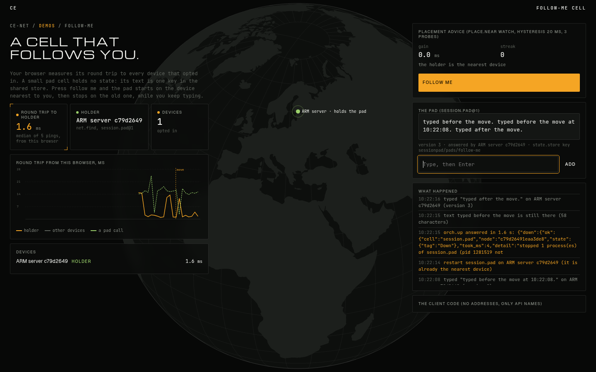

# Follow-me cell

A cell that follows you. Your browser measures its round trip to every device that opted in. A small pad cell,
`session.pad`, holds no state: its text is one key in the shared store (`state.store`). Press **Follow me** and the
pad starts on the device nearest to you, then stops on the old one, while you keep typing.



## How it works

Seven small cells, each with one job. The page calls them by api name only; the only address it has is the door in
its grant link, and each device's own door comes from `net.rtt` as data.

| Cell | Job | Repo |
|---|---|---|
| `net.rtt@1` | The probe target (`Ping`) and the memory of what a viewer measured (`Report`, `LatestOf`); `Devices` lists every device that runs it | ce-net/net-rtt |
| `place.near@1` | `Rank` devices by the viewer's own round trips; `Watch` streams advice and says `suggest` only when another device beats the holder by `hysteresis_ms` for `sustain` probes in a row | ce-net/place-near |
| `orch.up@1` | `Up`, `Down`, `Move` a cell on a named node through that node's `cell.install` (no ssh); only cells the deployment lists move | ce-net/orch-up |
| `session.pad@1` | `Append`, `Read`, `Subscribe`; each pad is one `state.store` key written with compare-and-set | ce-net/session-pad |
| `net.find@1` | Who holds an api now (`Find`) | ce-wire |
| `wire.ws-door@1` | A browser's WebSocket becomes a ce-wire connection; `Mint` makes the grant link | wire-ws-door |
| `globe.cells` | The globe contract the holder and the move arc are drawn in | globe-cells |

The move is `orch.up.Move{cell, from, to}`: `Up` on the new device first, then `Down` on the old one, so the api always
has a holder. A failed `Up` leaves the old one running. The pad text survives because it was never in the cell.

The four new cell repos are in the ce-net organisation and build on ce-wire, which is not public yet; the browser
clients they generate are in [sdk/](sdk/). The client the page runs is [src/follow.ts](src/follow.ts); the page shows it as it is.

## Run it in under 5 minutes

You need a ce node with the cells above (each is `cell-install install <api>`), Node 18+ and a browser.

```sh
git clone https://github.com/ce-net/demo-follow-me && cd demo-follow-me
./build.sh                                       # bundles site/follow-me/app.js (esbuild via npx)
cell-install install net.rtt; cell-install install place.near; cell-install install orch.up
echo ORCH_UP_CELLS=session.pad >> ~/.config/ce-door/env/orch.up.env    # the only cell orch.up may move
ce call orch.up.Up cell=session.pad on=here      # the pad, started through cell.install
(cd site && python3 -m http.server 18771 --bind 127.0.0.1 &)
wire-ws-door mint http://127.0.0.1:18771/follow-me/ net.rtt:read net.rtt:ping net.rtt:report \
  place.near:watch session.pad:read session.pad:append orch.up:move orch.up:up orch.up:down net.find:find --ttl 3600
```

Open the printed link with `&w=ws://127.0.0.1:7792/wire` appended (your node's ws-door). The grant is in the link
fragment and never reaches a server. `session.pad` needs a `state.store` grant for app `sessionpad` in the node wallet
(`state.store:sessionpad@<node16>`, abilities `state.sessionpad.pads.read|write`) and the schema in
[sessionpad-schema.json](sessionpad-schema.json) registered once.

A device opts in by running `net.rtt` next to its `wire.ws-door`, with `NET_RTT_WS_URL` (its door as seen by
browsers), `NET_RTT_LABEL` (a class name such as "ARM server") and a coarse `NET_RTT_LAT` / `NET_RTT_LON`.

Headless proof: `node proof/run.mjs '<link>' proof` (needs `puppeteer-core` and Chromium) opens the page, types,
presses Follow me, types again, and writes the screenshots and [proof/browser-run.json](proof/browser-run.json).

## Results (2026-11-15, one ARM server in Helsinki)

- Round trip from the browser to the device, median of the 20 recorded samples in proof/browser-run.json: 1.95 ms (spikes to 15 ms under build load);
  a pad call through the door including the `state.store` read: about 15 ms.
- Follow me with one device restarts the pad in place: `orch.up` Down then Up answered in 1.6 s; the pad process id
  changed; the text typed before (`version 2`) was there after, and the next append wrote `version 3`.
- Command-line run of the same step: [proof/cli-restart.txt](proof/cli-restart.txt).
- `place.near.Watch` said "the holder is the nearest device" with gain 0 ms, so it did not suggest a move: correct
  with one device.

The recorded run moves the pad between processes on one machine. A move between two devices is not yet recorded. The second device must issue this node a `cell.install` grant
(`install`, `stop` for `session.pad`) and a `state.store` grant for `sessionpad`, and run `net.rtt` and a ws-door
reachable from browsers.

## License

Apache-2.0. Author: Leif Rydenfalk.
